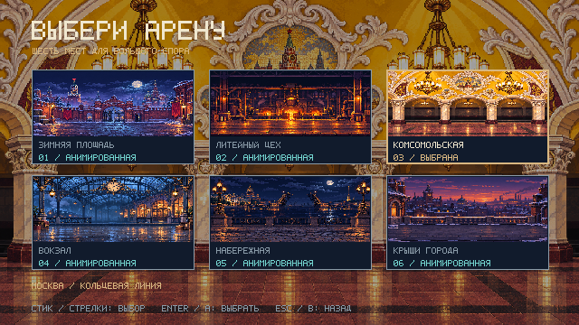
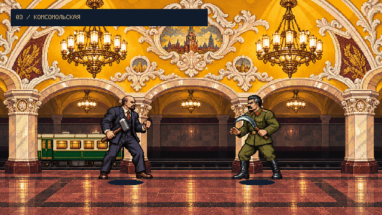

# Красный поединок · Red Rivalry

Юмористический пиксельный файтинг: Ленин бросается собственными книгами, Сталин пускает дым из трубки. Молот, серп, две арены и саундтрек в звучании Spectrum AY.

## Скачать и играть

### [⬇ Скачать для Windows x64](https://github.com/BurimBasic/redfight/releases/latest/download/RedRivalry-Windows-x64.zip)

**[Все версии и файлы релиза](https://github.com/BurimBasic/redfight/releases)**

1. Скачайте ZIP по ссылке выше.
2. Распакуйте архив целиком.
3. Откройте `RedRivalry/RedRivalry.exe`.

Unity для запуска не нужен. Файлы из архива должны оставаться рядом с игрой. Игра работает без интернета. Готовая сборка предназначена для Windows x64.


## Что внутри

- Одиночный бой с компьютером, три уровня сложности.
- Двое у одного экрана: клавиатура или до двух геймпадов Xbox / PlayStation, в том числе смешанная пара.
- Тренировка с восстановлением здоровья и энергии.
- Шесть арен с анимацией фона и отдельный экран выбора карты.
- Матч до двух побед, раунды по 90 секунд.
- Пиксельные персонажи, 12 кадров ходьбы, отдельные анимации книги и трубки.
- Оригинальная тема «Бумага и пар»: три голоса AY-3-8910, общий шум и аппаратная огибающая.

### Приёмы

| Боец | Спецприём | Особый приём | Суперудар |
| --- | --- | --- | --- |
| Ленин | Бросок книг «Что делать?», «Государство и революция», «Империализм» | «Сила аргумента»: книга и страницы оглушают вблизи | «Полное собрание сочинений»: три книги подряд |
| Сталин | Дым из трубки вызывает кашель | «Дымовая завеса»: краткая защита | «Большая затяжка»: усиленный дым |

### Арены

На экране выбора бойца нажмите **«Арена»** — откроется галерея всех шести карт. Управление: мышь, стрелки, крестовина или стик; × / A / Enter — выбрать, ○ / B / Esc — назад.



| Арена | Анимация |
| --- | --- |
| Зимняя площадь | Падающий снег и тёплые огни фонарей |
| Литейный цех | Летящие искры и мерцание раскалённых печей |
| Комсомольская | Пиксельная интерпретация реальной станции Кольцевой линии Московского метро: жёлтые своды, лепнина, колонны, люстры; поезд проходит за колоннами |
| Вокзал | Дождь, движущийся пар паровоза и блики на мокрой платформе |
| Набережная | Движущиеся блики на воде и небольшой катер |
| Крыши города | Снег на ветру и пар над трубами |

Все декоративные эффекты рисуются за бойцами и не меняют столкновения или дальность ударов. Изображение «Комсомольской» адаптировано под боковой ракурс файтинга; это художественная версия станции. [Архитектурная справка](https://www.culture.ru/institutes/13935/stanciya-metro-komsomolskaya), [описания генерации новых рисунков](docs/ARENA-ART-PROMPTS.json).



## Управление

| Действие | Игрок 1 | Игрок 2 | Xbox / XInput | DualShock 4 / PlayStation |
| --- | --- | --- | --- | --- |
| Движение | A / D | ← / → | Левый стик / крестовина | Левый стик / крестовина |
| Прыжок | W / пробел | ↑ | A / вверх | × / вверх |
| Приседание | S | ↓ | Вниз | Вниз |
| Лёгкий удар | J / левая кнопка мыши | Num1 | X | □ |
| Мощный удар | K / правая кнопка мыши | Num2 | Y | △ |
| Блок | Левый Shift / средняя кнопка мыши | Правый Shift | LB / LT | L1 / L2 |
| Спецприём | Q / U | Num4 | B | ○ |
| Особый приём | E / I | Num5 | RB | R1 |
| Суперудар | R / O | Num6 | RT | R2 |

**Esc / Start / Options** — пауза · **F11** — полный экран · **M** — звук.

Для второго игрока используется цифровой блок клавиатуры с включённым Num Lock. DualShock 4 определяется напрямую: DS4Windows и эмуляция Xbox не требуются. Все игровые действия и меню доступны с геймпада; подсказки автоматически используют символы PlayStation. Поддерживаются подключение во время игры и пауза при отключении. В меню **Управление → Проверить геймпад** можно проверить кнопки, оба стика, курки и запросить вибрацию кнопкой □ / X. Сетевого режима нет.

DualShock 4: управление по USB и Bluetooth; вибрация и цветовая полоса — по USB. Bluetooth-вибрация и гироскоп не поддерживаются выбранным модулем Unity ([официальные ограничения](https://docs.unity3d.com/Packages/com.unity.inputsystem@1.17/manual/SupportedDevices.html)). В игре гироскоп не используется. Поддержка USB и Bluetooth-пакетов проверяется автоматически; сведения о физической проверке приведены в релизе.

## Открыть исходники в Unity

Требуется **Unity 6.3 LTS — 6000.3.2f1**, для Windows-сборки — модуль Windows Build Support (Mono).

1. Скачайте исходники через **Code → Download ZIP** или клонируйте репозиторий.
2. В Unity Hub выберите **Add project from disk** и папку `UnityProject`.
3. Откройте `Assets/Scenes/RedRivalry.unity` и нажмите Play.

Скрипты находятся в `UnityProject/Assets/Scripts`, рисунки — в `Assets/Resources/Art`, музыка — в `Assets/Resources/Audio`.

Для сборки закройте открытый экземпляр этого проекта и запустите Unity из командной строки:

```text
Unity.exe -batchmode -nographics -projectPath "<путь>/UnityProject" -executeMethod BuildGame.Build -logFile "<путь>/build.log"
```

Сборка запускает проверки логики и создаёт `Windows/RedRivalry.exe` рядом с папкой проекта. Проверки управления используют реальные форматы USB/Bluetooth-пакетов DualShock, проверяют две независимые раскладки, удержание курков, отключение, повторное подключение и возврат фокуса. Отчёт об автоматизации не заменяет проверку на разных компьютерах и контроллерах.

## Музыка и авторство

В `Music` находятся MIDI, нотный эскиз LMMS и регистровая запись YM6. В `Music/AY-Source` — исходники для повторного рендера AY-звука через Node.js. Подробности: [Music/README.md](Music/README.md).

Графика создана с помощью ImageGen; музыка и игровой код подготовлены для этого проекта. Сторонний AY-эмулятор Ayumi распространяется под MIT, его лицензия сохранена. См. [CREDITS.md](CREDITS.md).

Это вымышленная альтернативная история и юмористическая игра. Проект не связан с Mortal Kombat и не использует его ресурсы.

Нашли ошибку? [Создайте issue](https://github.com/BurimBasic/redfight/issues/new), укажите версию игры, действие и ожидаемый результат. Скриншот или короткое видео помогут воспроизвести проблему.
